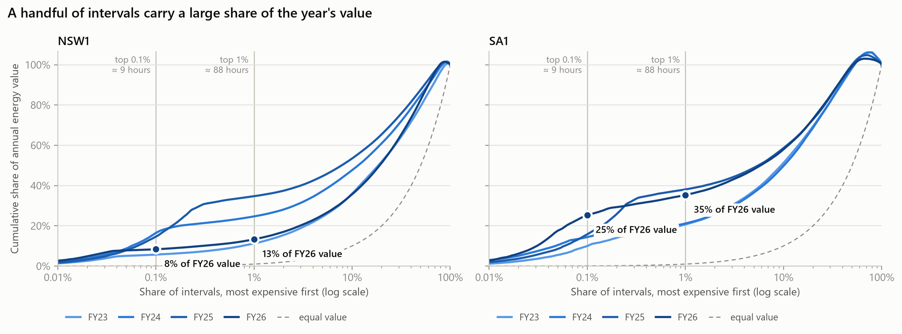

# NEM Price Anatomy

Where does the value in the National Electricity Market actually sit, and what drives it? This project uses five years of public AEMO 5-minute dispatch data for **NSW1** and **SA1**, from **1 October 2021** (the start of 5-minute settlement) to **30 September 2026**. It looks at five questions:

1. **Shape:** how does the daily price curve look by season, and how has it changed since 2021?
2. **Concentration:** what share of a year's energy value comes from the top 1% and 0.1% of intervals?
3. **Negative prices:** how often, when, and is it increasing?
4. **Spike anatomy:** what caused the biggest price events?
5. **NSW vs SA:** why is SA so much more volatile?

**Research note:** [note/](note/) _(link to the PDF once published)_

## Headline findings

<!-- Pick your 3 findings from the notebooks, each with a number. Keep claims exactly as strong as the data. -->

1. _…_
2. _…_
3. _…_



*Intervals sorted from most to least expensive. Value = price × operational demand × 5 minutes. Log x-axis; the top 1% of intervals is about 88 hours a year.*

## How to run it

Requires Python 3.12. About 0.5 GB of AEMO data is downloaded and cached under `data/` (git-ignored).

```powershell
py -3.12 -m venv .venv
.\.venv\Scripts\Activate.ps1
pip install -r requirements.txt

python src/download.py               # DISPATCHPRICE + DISPATCHREGIONSUM, NSW1 + SA1, Oct 2021 - Sep 2026
python src/clean.py                  # -> data/clean/nem_5min.parquet
python src/download_events.py        # interconnector flows + unit output around the spike events
python src/download_event_extras.py  # binding constraints + price setters for the same events
```

Then run the notebooks in order, with the working directory set to `notebooks/`:

| Notebook | Question | Key output |
|---|---|---|
| `01_validate` | Is the data right? | Row counts, range check vs price limits, time- vs demand-weighted averages |
| `02_shape` | Daily price shape by season and year; five years day by day | `charts/02_shape_*.png`, `charts/02_daily_price.png` |
| `03_concentration` | Share of value in the top 1% / 0.1% of intervals | `charts/03_concentration.png` |
| `04_negative` | Negative prices by hour × month, trend by year | `charts/04_negative_*.png` |
| `05_spikes` | The biggest events: demand, wind/solar, interconnectors, binding constraints, price setters | `charts/05_event_*.png` |
| `06_nsw_vs_sa` | Volatility, distributions, wind + solar share | `charts/06_*.png` |

## Repository layout

```
src/
  download.py               pulls AEMO MMSDM tables via NEMOSIS
  clean.py                  intervention filter, interval labels, helper columns, suspension flag
  download_events.py        event windows: DISPATCHINTERCONNECTORRES, DISPATCH_UNIT_SCADA, unit details
  download_event_extras.py  event windows: DISPATCHCONSTRAINT, NEMDE price setters
  chart_style.py            shared chart colours and style
notebooks/                  one notebook per question
charts/                     exported PNGs
note/                       the research note
```

## Data

**Sources** (all public):
- AEMO MMSDM archive on [NEMWeb](https://nemweb.com.au/Data_Archive/Wholesale_Electricity/MMSDM/), via [NEMOSIS](https://github.com/UNSW-CEEM/NEMOSIS): DISPATCHPRICE, DISPATCHREGIONSUM, DISPATCHINTERCONNECTORRES, DISPATCH_UNIT_SCADA, DUDETAILSUMMARY, DISPATCHCONSTRAINT, SPDINTERCONNECTORCONSTRAINT, GENCONDATA
- AEMO NEMDE NemPriceSetter files (NEMWeb `Data_Archive/Wholesale_Electricity/NEMDE`), the same source [NEMED](https://github.com/UNSW-CEEM/NEMED) uses
- AEMO NEM Registration and Exemption List, for unit fuel types

### Data notes

- **Intervention rows:** only `INTERVENTION = 0` is kept, so each interval appears once (6,974 intervention rows dropped per table).
- **5-minute settlement:** the sample starts with the interval beginning 1 Oct 2021 00:00 and ends with the one beginning 30 Sep 2026 23:55.
- **Timezone:** all timestamps are NEM time (AEST, UTC+10, no daylight saving); nothing is converted to Sydney local time.
- **Interval labels:** `SETTLEMENTDATE` marks the end of the 5-minute interval; `interval_start` = `SETTLEMENTDATE` − 5 min, and `hour`, `month`, `season`, `fy` and `is_weekend` are derived from it.
- **June 2022 market suspension:** intervals ending 15 Jun 2022 14:05 to 24 Jun 2022 14:00 are flagged `is_suspension` (2,592 per region), excluded from the main stats and analysed separately.
- **Duplicates and gaps:** 0 duplicate timestamps; every day has exactly 288 intervals per region.
- **Financial years and seasons:** `fy` runs July–June and is named by the year it ends (Oct 2021 = FY22). Seasons are southern-hemisphere (summer = Dec–Feb). FY22 (from October) and FY27 (July–September) are partial years and are flagged wherever they appear.
- **Value and averages:** value = RRP × TOTALDEMAND × 5/60 h. Both the time-weighted (simple mean) and demand-weighted averages are reported; demand-weighted is higher because high prices coincide with high demand.
- **Demand** is operational demand. Rooftop solar isn't dispatched, so it appears as lower demand rather than as generation.
- **Wind + solar** means semi-scheduled generation (`SEMISCHEDULE_CLEAREDMW`); available output is `UIGF`, and curtailment is the gap between them.
- **Unit fuel types** come from AEMO's current registration list. Units that have since left it (Liddell, and batteries registered as separate generate/charge units before mid-2024) are mapped by hand in `05_spikes`. Charging and pumping are counted as negative generation.

### Price limits

Market floor price: −$1,000/MWh throughout. Market price cap (MPC) by financial year, set by the AEMC's schedule of reliability settings:

| FY | MPC ($/MWh) |
|---|---|
| FY22 (2021–22) | 15,100 |
| FY23 (2022–23) | 15,500 |
| FY24 (2023–24) | 16,600 |
| FY25 (2024–25) | 17,500 |
| FY26 (2025–26) | 20,300 |
| FY27 (2026–27) | 23,200 |

FY23–FY27 values are from the AEMC's published schedules; FY22 matches the maximum price in the data. The maximum price equals the cap in every full FY, and no price sits below the floor.

### Validation (`01_validate`)

- **Row count:** 1,826 days × 288 intervals per region, no duplicates, no gaps.
- **External cross-check:** AEMO's [Quarterly Energy Dynamics Q2 2025](https://www.aemo.com.au/-/media/files/major-publications/qed/2025/qed-q2-2025.pdf) reports $161/MWh (NSW) and $140/MWh (SA); this pipeline's time-weighted averages are $160.68 and $140.21. QED's regional averages are time-weighted; the demand-weighted averages for the same quarter are ~$30 higher.
- **Range check:** every price sits between the floor and that FY's cap.
- **Excel cross-check:** _to do — recompute the October 2021 NSW1 average ($57.12) by hand from the raw AEMO file._

### Limitations

- Two regions only; Queensland, Victoria and Tasmania appear only through interconnector flows.
- Spike causes are read from public dispatch data (conditions, binding constraints, price setters). Bids and plant outages are inferred from those, not observed directly.
- AEMO's interconnector `EXPORTLIMIT`/`IMPORTLIMIT` columns often equal the flow, so interconnector congestion is judged from binding constraints instead.
