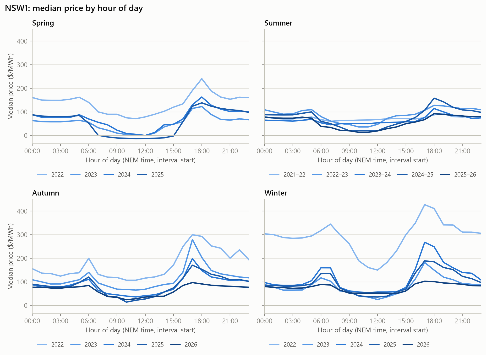
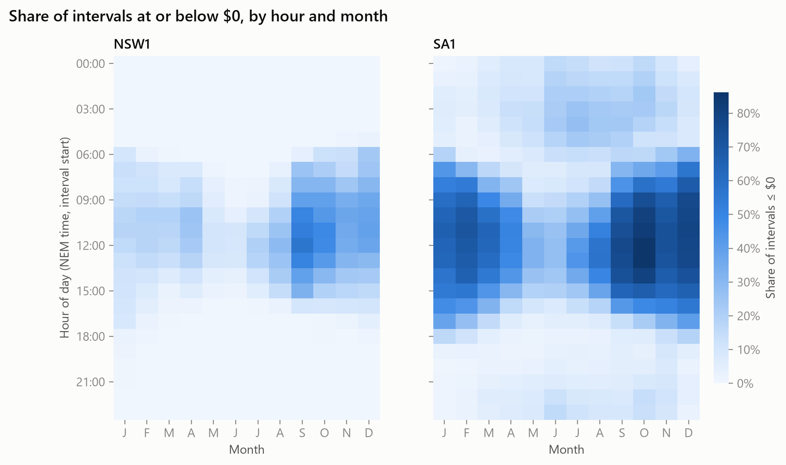
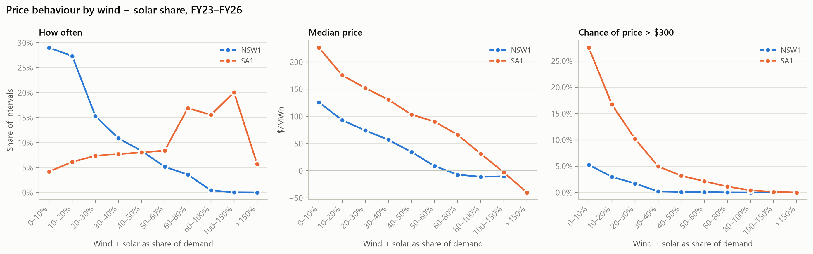

# NEM Price Anatomy: where the value sits in NSW and SA

**Anirudh · October 2026**

Five years of public AEMO 5-minute data for NSW1 and SA1 (1 Oct 2021 – 30 Sep 2026) show that a small number of intervals carry a large share of the year's wholesale energy value. This note looks at when those intervals happen, what causes them, and why SA behaves so differently from NSW.

---

## 1. Key findings

- **About a third of the year's value comes from about 88 hours.** In FY25 the most expensive 1% of intervals carried **35%** of NSW's annual energy value and **38%** of SA's. A $300 cap would have paid back **32%** (NSW) and **35%** (SA) of the year's total energy cost.
- **Negative prices are becoming more common, but shallower.** Hours at or below $0 rose from 405 to 1,091 in NSW and from 2,058 to 2,835 in SA (FY23 → FY26). The median negative price moved from −$34 (NSW) and −$47 (SA) in FY23 to about −$11 in FY26.
- **SA's volatility comes from wind and solar, not from fatter extreme tails.** Utility wind and solar cover **~70%** of SA's demand against **~25%** of NSW's. When they cover under 10% of demand, SA's price goes above $300 in **28%** of intervals, against 5% for NSW. Above about $5,000/MWh, the two regions spike about as often as each other.
- **Spikes are driven by constraints, not only by scarcity.** In every single-region event studied, a binding network constraint was holding imports back.

---

## 2. Price shape: the evening peak is flattening

Both regions show the solar "duck curve": a midday trough and an evening ramp.
- **NSW:** the summer midday median fell from $69/MWh (2021–22) to $22/MWh (2025–26), and the spring midday median went negative for the first time in 2025 (−$12).
- **SA:** midday medians have been below zero in summer and spring since 2023, but have been **rising back toward $0** (summer −$46 in 2022–23 → −$10 in 2025–26).

The bigger change in 2026 is at the evening peak:
- The winter evening median (17:00–20:55) fell from **$171 to $98** in NSW and from **$166 to $101** in SA between 2025 and 2026.
- The evening-minus-midday spread roughly halved: NSW **$131 → $46**, SA **$147 → $58**.

AEMO's Quarterly Energy Dynamics (QED) for Q2 2026 points to batteries. Across the NEM:
- Daytime battery charging (10:00–16:00) rose **+211%** year on year, and evening discharge (16:00–21:00) **+228%**.
- Battery discharge set the price in **46%** of evening-peak intervals.

Batteries charging at midday and discharging in the evening both lift the trough and cap the peak.

**For a trader:** the shape that made evening peaks expensive is being arbitraged away. That shrinks the intraday spread batteries earn from, and lowers the value of peak-shaped hedges.

---

## 3. Where the value sits

Sorting each year's intervals from most to least expensive and adding up price × energy shows how concentrated the value is:

| | Top 0.1% (~9 h) | Top 1% (~88 h) | $300 cap payout / annual cost | Hours > $300 |
|---|---|---|---|---|
| NSW1 FY25 | 15% | 35% | 32% | 126 |
| NSW1 FY26 | 8% | 13% | 9% | 47 |
| SA1 FY25 | 16% | 38% | 35% | 173 |
| SA1 FY26 | 25% | 35% | 32% | 155 |

Concentration is now a feature of short, extreme events rather than long expensive periods:
- **FY23** (after the 2022 energy crisis) had 635–850 hours above $300, but the top 1% carried only 11–21% of value.
- **FY25** had far fewer hours above $300, but the top 1% carried a third of value.
- **NSW was calm in FY26** (47 hours above $300, top 1% = 13%), while **SA stayed concentrated**: 25% of its FY26 value sat in about 9 hours.

AEMO splits each region's average price into an energy component (prices capped at $300) and a "cap return" (the part above $300). In Q2 2026:
- **NEM-wide:** the cap return fell to $3/MWh, from $37/MWh a year earlier.
- **NSW:** effectively $0.
- **SA:** $14.2/MWh, and **92%** of it came from a single event on 21–22 June 2026 (section 5).

---

## 4. Negative prices

Negative prices cluster at midday, when solar output is high and demand is low:
- **NSW:** the hottest cell is September, 11:00–13:55, where **51–56%** of intervals are at or below $0. Negative prices run across spring and early summer (Sep–Dec).
- **SA:** the hottest cell is October, 11:00–13:55, at **82–86%**. Negative prices are also heavy through **summer (Dec–Mar)**.
- **Overnight:** SA has a second, overnight band in winter (Jun–Sep, 00:00–06:00), which points to wind. In Q2 2026, **21.5%** of SA intervals between 00:00 and 03:55 were below $0. NSW has almost no overnight negative prices.

**Monthly:** the share of intervals at or below $0 ranged from about **7% to 50%** in SA and **0% to 31%** in NSW, peaking each spring and rising year on year.

**Prices are going negative more often but less deeply:**
- The median price in negative intervals rose to about **−$11** in FY26 in both regions.
- AEMO reports that in Q2 2026, **89%** of negative-price intervals across the NEM sat between −$10 and $0, up from 21% a year earlier. It links this to large-scale generation certificate (LGC) prices falling from about **$20 to $3**: renewable generators lose less certificate revenue by switching off, so they no longer bid deeply negative to keep running.

**For a trader:** midday is now a charging window rather than a deep discount. The battery spread comes from the evening peak, not from deeply negative midday prices.

---

## 5. Spike case studies

Events were defined as runs of intervals at or above $5,000/MWh, ranked by the dollar value traded at those prices. Each case uses AEMO's binding constraints and its price-setter files to identify what held the region back and whose bid set the price.

**SA, 26 January 2026: interconnectors held down on a hot evening.**
- Between 18:25 and 21:40, SA averaged **$18,399/MWh**, reaching the $20,300 cap.
- Demand rose to 3.0 GW as solar fell away, and spare capacity dropped from about 1,000 MW to **47 MW**.
- Two constraints bound throughout:
  - one held the Heywood interconnector to a **600 MW test limit**
  - another held Murraylink at **zero**
- Torrens Island battery and Torrens B gas units, bidding at about $19,440, set the price.

**NSW, 8 May 2024: a line outage cut off southern supply.**
- NSW's most expensive event: **$535m** at spike prices over 15:35–19:50, at an average of $14,956/MWh.
- Demand rose 1.6 GW into the evening while solar fell 1.1 GW.
- A stability constraint for the **Collector–Yass line outage** bound throughout, holding Victoria–NSW flow at about zero; NSW had been exporting about 650 MW south before the event.
- Bayswater coal units, bidding at $14,100, set the price most often, with Mt Piper and Tallawarra.
- AEMO notes the May 2024 events led to a period of administered pricing in NSW.

**NSW and SA, 26 June 2025: a NEM-wide low-wind winter evening.**
- Both regions spiked together over 16:45–20:55.
- NSW demand rose 3 GW to 11.4 GW, solar dropped 2.3 GW, and wind was only about 160 MW in NSW and 50 MW in SA. NSW's spare capacity fell from 5.6 GW to 0.9 GW.
- The southern interconnectors were not binding, so the regions priced as one market.
- **Batteries** in Victoria, SA and NSW, bidding at about $3,900–$9,400, set the price.

**SA, 21–22 June 2026: wind lull, constrained imports, flat batteries.**
- **Conditions** (AEMO QED Q2 2026):
  - Adelaide below 5°C and a three-day wind lull, with wind capacity factor under 5%.
  - A reduced rating on the X3 Balranald–Buronga line, which constrained imports into SA over both interconnectors.
- **Batteries ran down.** They discharged through the evening of 21 June, and their state of charge fell to about 10%.
- **The next morning:** prices hit the **$20,300 cap for 10 consecutive intervals** (07:15–08:00 interval start) on 22 June.

---

## 6. NSW vs SA

The two regions sit at opposite ends of the wind + solar range:
- **NSW** spends **56%** of intervals with wind + solar below 20% of demand. **SA** spends **41%** of intervals above 80%, and **27–28%** of intervals with wind + solar exceeding its entire demand.
- **SA's price at a given wind + solar share is higher** than NSW's: its median is **$226/MWh** when wind + solar cover under 10% of demand ($176 at 10–20%), against $126 for NSW.
- **When wind + solar exceed demand,** SA's median price falls below zero.

Three structural features explain the gap:
1. **Scale.** SA's average demand is about 1.3 GW against NSW's 7.5 GW, so a 200 MW unit trip or interconnector limit is about 15% of SA's demand and under 3% of NSW's.
2. **Import reliance.** SA imports more than 20% of its demand in 25–38% of intervals; NSW does so in about 4%.
3. **Firm supply.** When wind drops, SA relies on gas turbines, batteries and imports. NSW still has a large coal fleet.

**Where the volatility actually is.** SA's middle-50% price spread (IQR) is **1.9–2.2×** NSW's, its typical daily price range is wider, and it has 2.6–5× the negative-price hours. Above about $5,000/MWh, though, the two regions spike about as often as each other. SA's extra volatility is in typical trading and the $300–$1,000 range, not in more frequent extreme spikes.

---

## 7. Implications for traders and hedgers

- **Caps are valuable because value is concentrated.** In FY25 a $300 cap returned about a third of the year's energy cost in both regions. In FY26 it returned 32% in SA but only 9% in NSW, which shows how much cap value depends on a handful of events in each year.
- **Price the network, not just the weather.** Every single-region spike studied had a binding import constraint, such as a line outage, a test limit or a line rating. Outage and constraint notices are as important an input as weather forecasts.
- **Battery economics are shifting.** The evening–midday spread roughly halved in 2026 as battery fleets grew and began setting evening prices. This suggests more of a battery's value will depend on being charged going into rare scarcity events, such as the SA cap intervals on 22 June 2026, rather than on the everyday spread.
- **SA demands a higher risk premium.** SA's demand-weighted price is up to 41% above its time-weighted price (FY26), against 13% for NSW. The load a retailer serves pays well above the simple average price, so retail and hedge pricing need to reflect the shape, not just the average.

---

## 8. Data and method

**Data**
- AEMO MMSDM archive via NEMOSIS: DISPATCHPRICE and DISPATCHREGIONSUM for NSW1 and SA1, 1 Oct 2021 – 30 Sep 2026 (525,888 intervals per region).
- For the event windows: interconnector results, unit SCADA, binding constraints (DISPATCHCONSTRAINT), and NEMDE price-setter files.

**Cleaning**
- Kept only the non-intervention run.
- Used NEM time (UTC+10) throughout.
- Labelled each interval by its start (`SETTLEMENTDATE` − 5 min).
- Flagged the June 2022 market suspension (15–24 June) and excluded it from the main statistics.
- No duplicates or gaps: every day has 288 intervals.

**Validation**
- Q2 2025 time-weighted averages of **$160.68 (NSW)** and **$140.21 (SA)** match AEMO QED's **$161 / $140**.
- Every full FY's maximum equals that year's market price cap.

**Definitions**
- Value = price × operational demand × 5 minutes.
- Wind + solar = semi-scheduled dispatch as a share of operational demand.
- "Negative" means at or below $0.

**Limitations**
- Only two regions are covered.
- Spike causes are inferred from dispatch data, constraints and price setters, not from bids or outage records.
- Battery economics are discussed qualitatively and exclude FCAS revenue.
- Rooftop solar appears only as lower demand.

**Further work**
- Bid stacks and rebids around the spike events.
- Predispatch forecast accuracy before spikes.
- A battery revenue backtest including FCAS.

**Sources**
- AEMO NEMWeb (MMSDM, NEMDE).
- AEMO, [Quarterly Energy Dynamics Q2 2025](https://www.aemo.com.au/-/media/files/major-publications/qed/2025/qed-q2-2025.pdf) and [Q2 2026](https://www.aemo.com.au/-/media/files/major-publications/qed/2026/qed-q2-2026.pdf).
- AEMC schedules of reliability settings.

Code and notebooks: [github.com/AnirudhGupta004/nem-price-anatomy](https://github.com/AnirudhGupta004/nem-price-anatomy)
